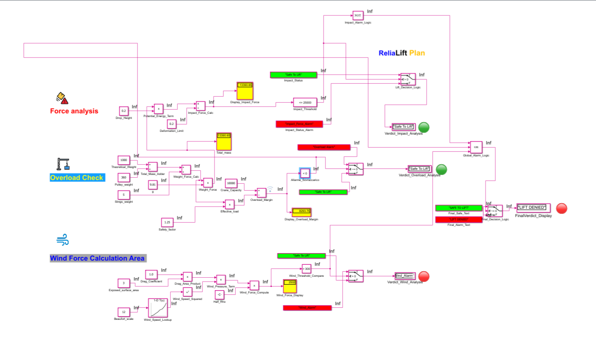

# Simulift


**Predictive Safety Model for Lifting Operations**  
Built in MATLAB Simulink – created by [Gianluigi Riccardi](https://www.linkedin.com/in/gianluigi-riccardi-ai-industrial)



---

## What's new in v1.2

- **Status lamps.** `SimuLift_v1_2_WithLamps.slx` adds one lamp per check (impact, overload, wind) and a final lamp for the global verdict, so the outcome is readable at a glance.
- **Lift data from Excel.** `SimuLift_Dati_Sollevamento.xlsx` is the single input template: fill in the values of a lift and run `simulift_import_excel` to write them into the model blocks. A copy of the model with the updated values is saved next to the original.
- **2D animation.** `simulift_animate_2d` reads the same Excel file, recomputes the three checks with the same formulas and thresholds as the model and shows a simple scene: crane, load being lifted, wind and the verdict. `SimuLift_WithAnimation.slx` opens it from a block inside the model.

```matlab
% Write the Excel values into the model (saves SimuLift_v1_2_WithLamps_aggiornato.slx)
simulift_import_excel('SimuLift_Dati_Sollevamento.xlsx', 'SimuLift_v1_2_WithLamps.slx')

% Run the 2D animation, optionally saving a GIF
simulift_animate_2d('SimuLift_Dati_Sollevamento.xlsx', true)
```

### The Excel input template

`SimuLift_Dati_Sollevamento.xlsx` lets whoever plans the lift prepare the check without opening Simulink. Fill in only the yellow cells in the "Valore" column; do not edit the "Blocco Simulink" column, which holds the exact name of the block each value is written to.

| Parameter | Simulink block | Unit | Template value |
|---|---|---|---|
| Load to lift | `Theoretical_Weight` | kg | 1000 |
| Hook block | `Pulley_weight` | kg | 360 |
| Chains or slings | `Slings_weight` | kg | 100 |
| Safety factor | `Safety_factor` | - | 1.25 |
| Drop height | `Drop_Height` | m | 10 |
| Admissible deformation | `Deformation_Limit` | m | 0.2 |
| Wind (Beaufort scale) | `Beaufort_scale` | 0-12 | 3 |
| Area exposed to wind | `Exposed_surface_area` | m² | 3 |
| Crane capacity at the working radius | `Crane_Capacity` | kg | 7500 |

`simulift_import_excel` reads the sheet "Dati Sollevamento", writes each value into the matching Constant block and saves a copy of the model with `_aggiornato` in the name, leaving the original untouched. The same file drives `simulift_animate_2d`, so the animation always shows the same lift as the model. The template values are examples: replace them with the data of the actual lift.

The v1.0 model (`SimuLift (4).slx`) and the v1.1 scripts remain in the repository unchanged.

**Note on the impact check.** The impact criterion models a full drop of the load from `Drop_Height` onto a surface that deforms by `Deformation_Limit`. With the template values (1460 kg total, 10 m, 0.2 m) it gives about 716 kN against a 25 kN threshold, so the global verdict is LIFT DENIED by design. It is a worst-case awareness check, not a verdict on a normal lift: adapt the drop height, the deformation and the threshold to the scenario you want to assess.

**Limits.** SimuLift is a demonstration and research tool. It does not replace a lift plan, the crane load charts, a competent person's assessment or the applicable standards.

---

## 🚀 Overview

**Simulift** is a predictive safety tool designed to simulate real lifting conditions using physics-based logic.  
It checks whether a lift is safe by evaluating:

- **Impact force** (from drop height & deformation)
- **Overload** (mass vs crane capacity with safety factor)
- **Wind force** (based on Beaufort scale)

Final verdicts like ✅ **Safe to Lift** or ❌ **Overload Detected** are clearly shown via visual displays.

---

## 📦 Download & Quick Start

**[Download everything (ZIP)](https://github.com/GianluigiRiccardi/SimuLift/archive/refs/heads/main.zip)**: v1.2 model, Excel template and scripts in one package.

Looking for the original v1.0 model? [Download SimuLift (4).slx](https://github.com/GianluigiRiccardi/SimuLift/raw/main/SimuLift%20(4).slx).

**New!** 🎉 **Automated Scripts Available**

SimuLift now includes MATLAB automation scripts for easier usage:
- **`run_simulift.m`** - Main entry point with predefined scenarios
- **`SimuLiftUtils.m`** - Utility functions for calculations
- **`test_simulift.m`** - Validation test suite
- **`examples.m`** - Usage examples and demonstrations

See [QUICKSTART.md](QUICKSTART.md) for detailed usage instructions.

### Quick Usage
```matlab
% Run with default scenario
run_simulift()

% Run predefined scenarios
run_simulift('scenario', 'light_load')
run_simulift('scenario', 'heavy_wind')

% Run validation tests
test_simulift()
```

---

## 📊 Example Scenario

Lifting a 3000 kg payload during wind force 6 (Beaufort):

- Set slings, pulley, and load weight
- Apply deformation limit: 0.2 m  
- Safety Factor: 1.25  
- Exposed area: 1.5 m²

Run the model and observe the visual verdict.

---

### ⚠️ Impact Force – Engineering Note

The impact force is calculated using the simplified physics formula:
F = (m · g · h) / Δs

Where:  
- `m` = mass of the object  
- `g` = gravitational acceleration  
- `h` = drop height  
- `Δs` = deformation or stop distance

This formula estimates the **maximum instantaneous force** transmitted during an impact.

Even a **40 kg pipe falling from 2 meters** with only **1 cm of deformation** can generate:

F = (40 · 9.81 · 2) / 0.01 = 78,480 N

That’s **almost 800 kgf**, potentially enough to damage another pipe, especially if the contact point is narrow or the material is rigid.

**SimuLift uses this conservative approach** to highlight real industrial risks often underestimated during field operations.

---

## 🔧 Parameters You Can Modify

| Parameter            | Block Name            | Affects                         |
|---------------------|------------------------|---------------------------------|
| Payload              | `Theoretical_Weight`   | Load force                      |
| Pulley               | `Pulley_Weight`        | Total mass                      |
| Slings               | `Slings_Weight`        | Total mass                      |
| Safety Factor        | `Safety_Factor`        | Load * multiplier               |
| Drop Height          | `Height`               | Impact energy                   |
| Deformation limit    | `Deformation_Limit`    | Impact force                    |
| Beaufort Scale       | `Beaufort_Scale`       | Wind speed                      |
| Exposed Area         | `Exposed_Area`         | Wind pressure                   |

---

## 🖥 Output Verdicts

- **OK**
- **Alarm**

| Display Block         | Shows                  |
|-----------------------|------------------------|
| `Impact_Status`       | Impact risk            |
| `Overload_Status`     | Load/capacity risk     |
| `Wind_Status`         | Wind force condition   |
| `FinalVerdict_Display`| Global lift verdict    |

---

## 📚 Resources

- [Quick Start Guide](QUICKSTART.md) - Get started quickly with automated scripts
- [Simulink Documentation](https://www.mathworks.com/help/simulink/)
- [Beaufort Wind Scale](https://en.wikipedia.org/wiki/Beaufort_scale)
- [OSHA Crane Lifting Standards](https://www.osha.gov/cranes-derricks)

---

## 🆕 New Features (v1.1)

- **Automated scripts** for programmatic simulation control
- **Predefined scenarios** (light load, heavy load, high wind, critical)
- **Utility functions** for standalone calculations
- **Comprehensive test suite** for validation
- **Example scripts** demonstrating various use cases
- **Safety report generation** with detailed analysis
- **Batch processing** capabilities for multiple scenarios

---

## 📖 Documentation

- **[QUICKSTART.md](QUICKSTART.md)** - Quick start guide with examples
- **[README_SimuLift.md](README_SimuLift.md)** - Detailed technical documentation
- **[examples.m](examples.m)** - Interactive examples and demonstrations

---

## 🔄 Changelog

**v1.2 – 2026**  
- Status lamps per check and global verdict  
- Excel input template and import script  
- 2D animation driven by the same data and formulas

**v1.0 – May 2025**  
- Full predictive model  
- 3 safety subsystems  
- GitHub Pages and documentation added

---

## 🌐 GitHub Page

View the public version of this project:  
https://gianluigiriccardi.github.io/SimuLift/

---

## 🛡️ License

MIT License – use, adapt, and contribute freely.
