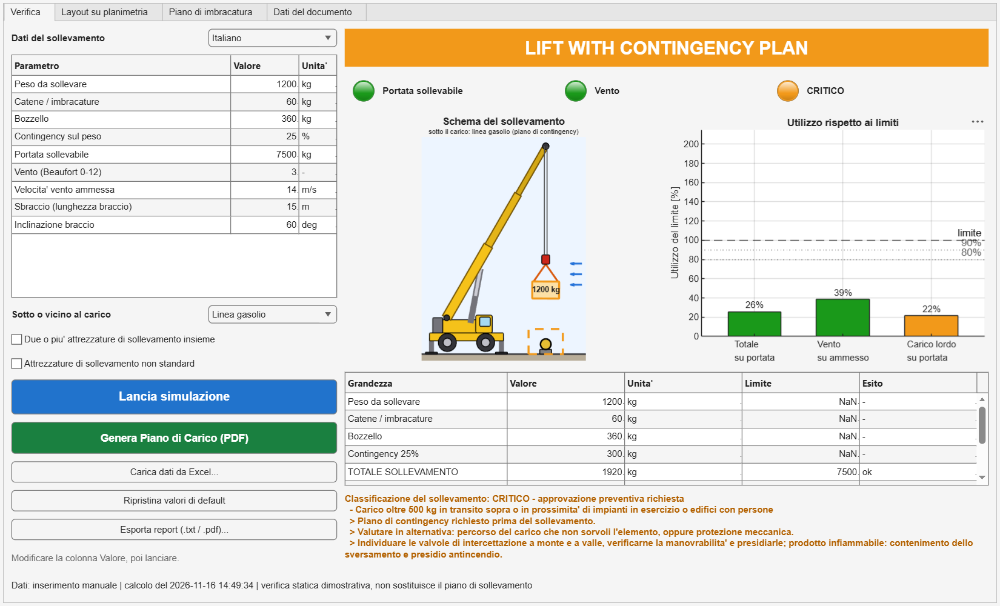
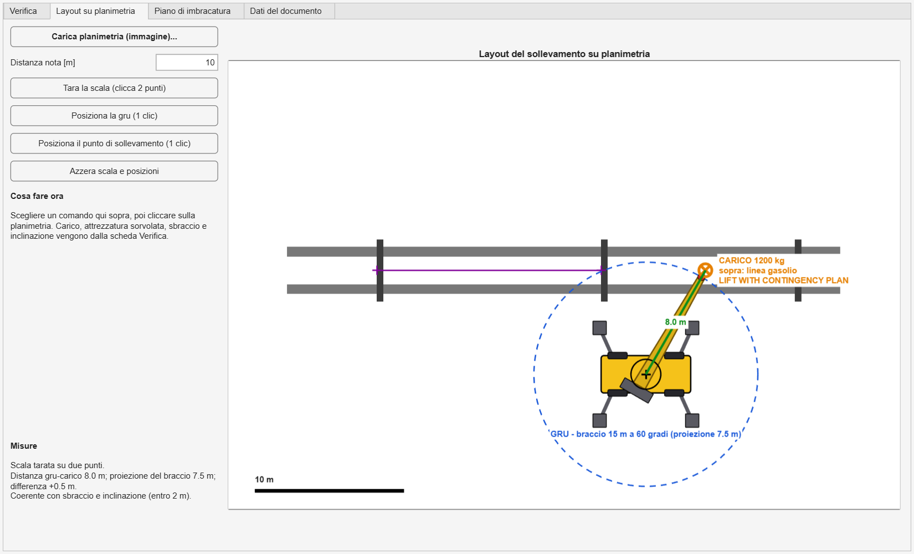
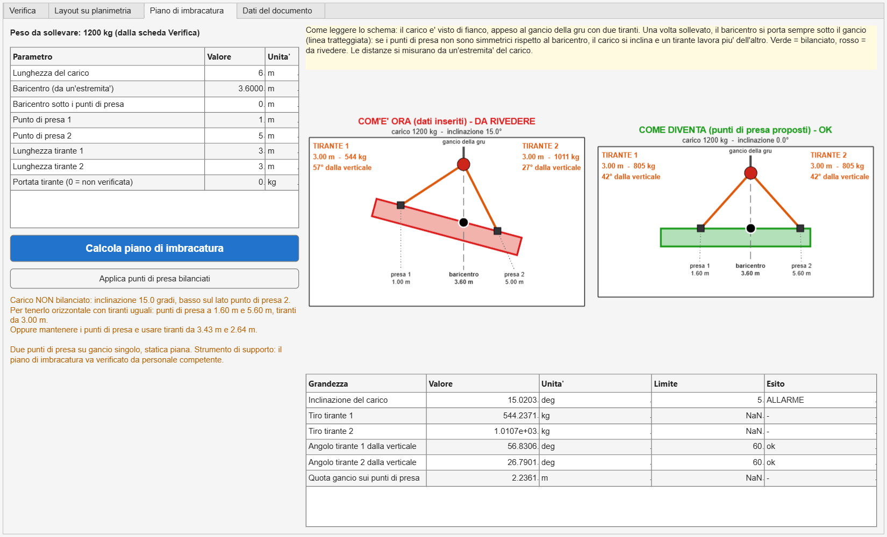

# Simulift


**Lift planning for mobile cranes, from the load check to the signed Load Plan**  
Built in MATLAB – created by [Gianluigi Riccardi](https://www.linkedin.com/in/gianluigi-riccardi-ai-industrial)



---

## What's new in v2.0: the SimuLift app

v2.0 turns SimuLift from a Simulink verifier into a MATLAB app that prepares the decisions behind a lift: whether it can go ahead, which class it falls into, who has to approve it and what must be in place if the load passes over plant in service. It ends with a **Load Plan in PDF** generated with one button.

```matlab
SimuLiftApp          % Italian interface
SimuLiftApp("en")    % English interface
```

| Tab | What it does |
|---|---|
| **Check** | Load summary (load, slings, hook block, contingency as a percentage of the load) against the liftable capacity, wind checked as a speed against the crane's in-service limit, lift classification, mobile crane sketch with the boom to scale |
| **Layout on site plan** | Load a site plan as an image, set the scale from two points, place the crane (top view) and the lift point, compare the measured distance with the horizontal projection of the boom |
| **Rigging plan** | Two pick points on a single hook: load tilt, sling tensions and angles, and the pick points that keep the load level, shown side by side with the current set-up |
| **Document data** | Job, site, roles and equipment data for the Load Plan, then **Generate Load Plan (PDF)** |

**Three verdicts.** `LIFT DENIED` when the total exceeds the liftable capacity or the wind exceeds the allowed speed. `LIFT WITH CONTINGENCY PLAN` when the numbers are fine but the load travels over something that must not break: above 500 kg over plant in service or occupied buildings, or any load over power lines or plant holding toxic gas; the app lists the contingency actions. `SAFE TO LIFT` otherwise.

**Lift class.** STANDARD, NON-STANDARD or CRITICAL, with the reasons. The thresholds are settings of the tool, defined in `simulift_static_check.m`.





An example of the generated document, with fictitious names and data: [docs/Piano_di_Carico_esempio.pdf](docs/Piano_di_Carico_esempio.pdf). The Load Plan is written in Italian.

From the command line, for example on MATLAB Mobile:

```matlab
SimuLift_Mobile(Load_kg=1200, Slings_kg=60, Asset="diesel")
```

**How the numbers are computed.**
- Total lift = load + slings + hook block + contingency, with the contingency applied to the load only.
- The liftable capacity is an input read from the manufacturer's load chart for the planned radius and configuration. Boom length and angle drive the drawings and the layout check; they are not used to compute the capacity.
- Wind: the Beaufort force is converted to the upper speed of its class and compared with the crane's allowed in-service speed.
- Rigging: plane statics of a rigid body on inextensible slings. The centre of gravity settles under the hook; tilt and tensions follow from the geometry. Limits: 60° between sling and vertical, 5° of load tilt (design assumption).

**Tests.** 25 `matlab.unittest` tests: 18 on the load check and classification (`test_simulift_static_check.m`), 7 on the rigging plan (`test_simulift_rigging.m`), including the analytical solution of the symmetric case and force and moment equilibrium.

**Limits of v2.0.** Static check only, no load dynamics. Capacity is an input, not computed from a load chart. Rigging covers two pick points on a single hook, not four-point lifts or spreader beams. Site plans are loaded as images (PNG, JPEG, TIFF, BMP): export DWG, DXF or PDF drawings first. The risk ratings, procedure steps and contingency actions in the PDF are a generic starting point, to be reviewed and confirmed by whoever writes and approves the plan. Requires MATLAB R2026a; no extra toolbox for the app and the PDF.

**Not a digital twin.** SimuLift works on data entered by a person before the lift: it is a digital model. Linking it to a specific crane's load chart and to field data (load cell, boom angle, anemometer) is the path towards a digital shadow and, later, a digital twin.

**About the v1.x criteria.** v1.x checks a full drop of the load (`F = m·g·h/δ`) and applies a safety factor to the total. v2.0 replaces the impact check with the contingency rule and uses a contingency on the load. In `simulift_animate_2d.m` the overload margin compares newtons with kilograms and the Beaufort table lacks force 8; the v1.x files stay in the repository unchanged, as a reference, and are not used by the app.

---

## What's new in v1.2

- **Status lamps.** `SimuLift_v1_2_WithLamps.slx` adds one lamp per check (impact, overload, wind) and a final lamp for the global verdict, so the outcome is readable at a glance.
- **Lift data from Excel.** `SimuLift_Dati_Sollevamento.xlsx` is the single input template: fill in the values of a lift and run `simulift_import_excel` to write them into the model blocks. A copy of the model with the updated values is saved next to the original.
- **2D animation.** `simulift_animate_2d` reads the same Excel file, recomputes the three checks with the same formulas and thresholds as the model and shows a simple scene: crane, load being lifted, wind and the verdict. `SimuLift_WithAnimation.slx` opens it from a block inside the model.

```matlab
% Write the Excel values into the model (saves SimuLift_v1_2_WithLamps_aggiornato.slx)
simulift_import_excel('SimuLift_Dati_Sollevamento.xlsx', 'SimuLift_v1_2_WithLamps.slx')

% Run the 2D animation, optionally saving a GIF
simulift_animate_2d('SimuLift_Dati_Sollevamento.xlsx', true)
```

### The Excel input template

`SimuLift_Dati_Sollevamento.xlsx` lets whoever plans the lift prepare the check without opening Simulink. Fill in only the yellow cells in the "Valore" column; do not edit the "Blocco Simulink" column, which holds the exact name of the block each value is written to.

| Parameter | Simulink block | Unit | Template value |
|---|---|---|---|
| Load to lift | `Theoretical_Weight` | kg | 1000 |
| Hook block | `Pulley_weight` | kg | 360 |
| Chains or slings | `Slings_weight` | kg | 100 |
| Safety factor | `Safety_factor` | - | 1.25 |
| Drop height | `Drop_Height` | m | 10 |
| Admissible deformation | `Deformation_Limit` | m | 0.2 |
| Wind (Beaufort scale) | `Beaufort_scale` | 0-12 | 3 |
| Area exposed to wind | `Exposed_surface_area` | m² | 3 |
| Crane capacity at the working radius | `Crane_Capacity` | kg | 7500 |

`simulift_import_excel` reads the sheet "Dati Sollevamento", writes each value into the matching Constant block and saves a copy of the model with `_aggiornato` in the name, leaving the original untouched. The same file drives `simulift_animate_2d`, so the animation always shows the same lift as the model. The template values are examples: replace them with the data of the actual lift.

The v1.0 model (`SimuLift (4).slx`) and the v1.1 scripts remain in the repository unchanged.

**Note on the impact check.** The impact criterion models a full drop of the load from `Drop_Height` onto a surface that deforms by `Deformation_Limit`. With the template values (1460 kg total, 10 m, 0.2 m) it gives about 716 kN against a 25 kN threshold, so the global verdict is LIFT DENIED by design. It is a worst-case awareness check, not a verdict on a normal lift: adapt the drop height, the deformation and the threshold to the scenario you want to assess.

**Limits.** SimuLift is a demonstration and research tool. It does not replace a lift plan, the crane load charts, a competent person's assessment or the applicable standards.

---

## 🚀 Overview

**Simulift** is a predictive safety tool designed to simulate real lifting conditions using physics-based logic.  
It checks whether a lift is safe by evaluating:

- **Impact force** (from drop height & deformation)
- **Overload** (mass vs crane capacity with safety factor)
- **Wind force** (based on Beaufort scale)

Final verdicts like ✅ **Safe to Lift** or ❌ **Overload Detected** are clearly shown via visual displays.

---

## 📦 Download & Quick Start

**[Download everything (ZIP)](https://github.com/GianluigiRiccardi/SimuLift/archive/refs/heads/main.zip)**: v1.2 model, Excel template and scripts in one package.

Looking for the original v1.0 model? [Download SimuLift (4).slx](https://github.com/GianluigiRiccardi/SimuLift/raw/main/SimuLift%20(4).slx).

**New!** 🎉 **Automated Scripts Available**

SimuLift now includes MATLAB automation scripts for easier usage:
- **`run_simulift.m`** - Main entry point with predefined scenarios
- **`SimuLiftUtils.m`** - Utility functions for calculations
- **`test_simulift.m`** - Validation test suite
- **`examples.m`** - Usage examples and demonstrations

See [QUICKSTART.md](QUICKSTART.md) for detailed usage instructions.

### Quick Usage
```matlab
% Run with default scenario
run_simulift()

% Run predefined scenarios
run_simulift('scenario', 'light_load')
run_simulift('scenario', 'heavy_wind')

% Run validation tests
test_simulift()
```

---

## 📊 Example Scenario

Lifting a 3000 kg payload during wind force 6 (Beaufort):

- Set slings, pulley, and load weight
- Apply deformation limit: 0.2 m  
- Safety Factor: 1.25  
- Exposed area: 1.5 m²

Run the model and observe the visual verdict.

---

### ⚠️ Impact Force – Engineering Note

The impact force is calculated using the simplified physics formula:
F = (m · g · h) / Δs

Where:  
- `m` = mass of the object  
- `g` = gravitational acceleration  
- `h` = drop height  
- `Δs` = deformation or stop distance

This formula estimates the **maximum instantaneous force** transmitted during an impact.

Even a **40 kg pipe falling from 2 meters** with only **1 cm of deformation** can generate:

F = (40 · 9.81 · 2) / 0.01 = 78,480 N

That’s **almost 800 kgf**, potentially enough to damage another pipe, especially if the contact point is narrow or the material is rigid.

**SimuLift uses this conservative approach** to highlight real industrial risks often underestimated during field operations.

---

## 🔧 Parameters You Can Modify

| Parameter            | Block Name            | Affects                         |
|---------------------|------------------------|---------------------------------|
| Payload              | `Theoretical_Weight`   | Load force                      |
| Pulley               | `Pulley_Weight`        | Total mass                      |
| Slings               | `Slings_Weight`        | Total mass                      |
| Safety Factor        | `Safety_Factor`        | Load * multiplier               |
| Drop Height          | `Height`               | Impact energy                   |
| Deformation limit    | `Deformation_Limit`    | Impact force                    |
| Beaufort Scale       | `Beaufort_Scale`       | Wind speed                      |
| Exposed Area         | `Exposed_Area`         | Wind pressure                   |

---

## 🖥 Output Verdicts

- **OK**
- **Alarm**

| Display Block         | Shows                  |
|-----------------------|------------------------|
| `Impact_Status`       | Impact risk            |
| `Overload_Status`     | Load/capacity risk     |
| `Wind_Status`         | Wind force condition   |
| `FinalVerdict_Display`| Global lift verdict    |

---

## 📚 Resources

- [Quick Start Guide](QUICKSTART.md) - Get started quickly with automated scripts
- [Simulink Documentation](https://www.mathworks.com/help/simulink/)
- [Beaufort Wind Scale](https://en.wikipedia.org/wiki/Beaufort_scale)
- [OSHA Crane Lifting Standards](https://www.osha.gov/cranes-derricks)

---

## 🆕 New Features (v1.1)

- **Automated scripts** for programmatic simulation control
- **Predefined scenarios** (light load, heavy load, high wind, critical)
- **Utility functions** for standalone calculations
- **Comprehensive test suite** for validation
- **Example scripts** demonstrating various use cases
- **Safety report generation** with detailed analysis
- **Batch processing** capabilities for multiple scenarios

---

## 📖 Documentation

- **[QUICKSTART.md](QUICKSTART.md)** - Quick start guide with examples
- **[README_SimuLift.md](README_SimuLift.md)** - Detailed technical documentation
- **[examples.m](examples.m)** - Interactive examples and demonstrations

---

## 🔄 Changelog

**v2.0 – November 2026**  
- SimuLift app (Italian and English): load check with contingency, wind as speed, lift classification, contingency plan  
- Layout on a site plan with the crane seen from above  
- Two-point rigging plan with level-load proposal  
- Load Plan in PDF, command-line version for MATLAB Mobile, 25 unit tests

**v1.2 – 2026**  
- Status lamps per check and global verdict  
- Excel input template and import script  
- 2D animation driven by the same data and formulas

**v1.0 – May 2025**  
- Full predictive model  
- 3 safety subsystems  
- GitHub Pages and documentation added

---

## 🌐 GitHub Page

View the public version of this project:  
https://gianluigiriccardi.github.io/SimuLift/

---

## 🛡️ License

MIT License – use, adapt, and contribute freely.
