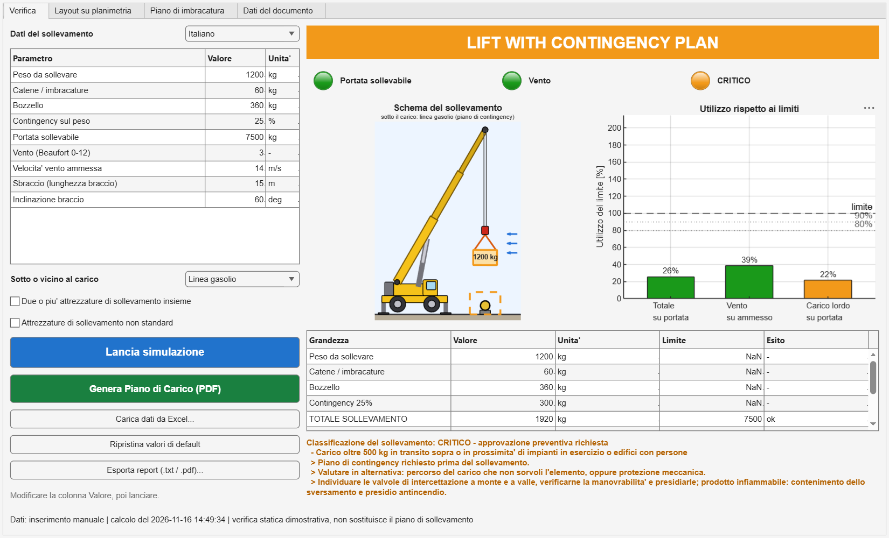
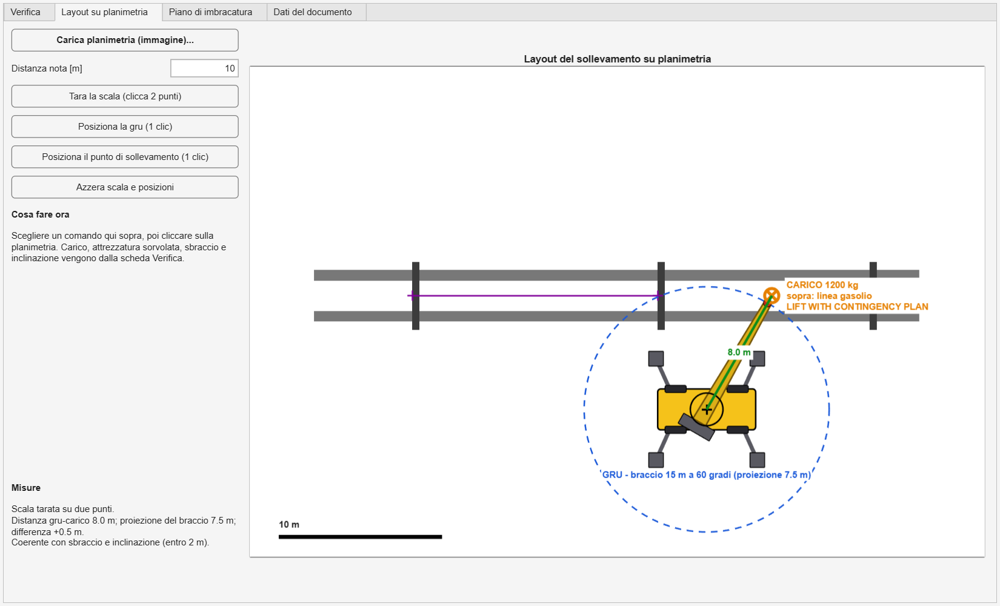
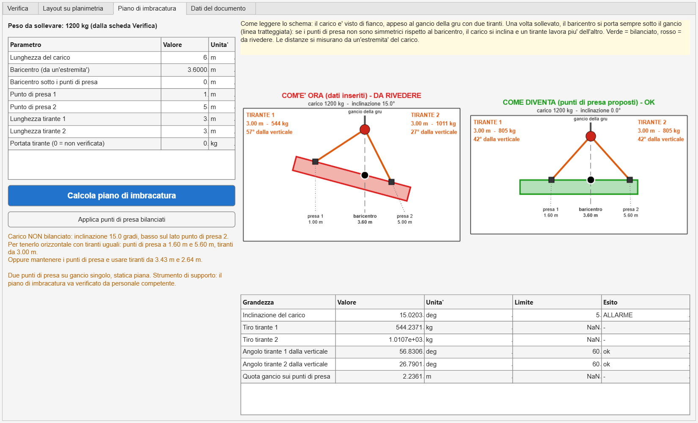

<!doctype html>
<html lang="en">
<head>
<meta charset="utf-8">
<meta name="viewport" content="width=device-width, initial-scale=1">
<title>SimuLift. The hook goes up only after the signature</title>
<meta name="description" content="SimuLift is a MATLAB app for planning a mobile crane lift: load check, lift classification, contingency plan over plant in service, layout on a site plan, two-point rigging plan and a Load Plan in PDF.">
<link rel="preconnect" href="https://fonts.googleapis.com">
<link rel="preconnect" href="https://fonts.gstatic.com" crossorigin>
<link href="https://fonts.googleapis.com/css2?family=Archivo:wdth,wght@100..125,400..800&family=Source+Serif+4:opsz,wght@8..60,400;8..60,600&display=swap" rel="stylesheet">

</head>
<body>
<header>
  

    <h1>SimuLift</h1>
    
The hook goes up only after the signature

    <a class="btn primary" href="https://github.com/GianluigiRiccardi/SimuLift/archive/refs/heads/main.zip">Download everything (ZIP)</a>
    <a class="btn secondary" href="docs/Piano_di_Carico_esempio.pdf">Sample Load Plan (PDF)</a>
    <a class="btn secondary" href="https://github.com/GianluigiRiccardi/SimuLift">View the code on GitHub</a>
  

</header>
<main>
  

    
SimuLift 2.0 is a MATLAB app that prepares the decisions behind a mobile crane lift and writes them into a Load Plan you can sign.

    
The capacity check is the easy part of a lift plan. What decides the outcome is what is often left implicit: which class the lift falls into, who has to approve it, and what happens if the load drops onto a line in service. SimuLift makes those decisions explicit before anyone hooks the load, and puts them on paper with one button.

    <figure class="model">
      
      <figcaption>The Check tab. Example with fictitious data: a 1,200 kg pipe spool lifted over a diesel line in service.</figcaption>
    </figure>

    <h2>Three verdicts</h2>
    
LIFT DENIED
The total lift exceeds the liftable capacity, or the forecast wind exceeds the crane's allowed in-service speed. The answer is no.

    
LIFT WITH CONTINGENCY PLAN
The numbers are fine, but the load travels over something that must not break: above 500 kg over plant in service or occupied buildings, or any load over power lines or plant holding toxic gas. The answer is yes, once the contingency actions are written and in place.

    
SAFE TO LIFT
Every other case.

    
Each lift is also classified as standard, non-standard or critical, with the reasons, so the plan states who must approve it.

    <h2>What it computes</h2>
    
<b>Load summary</b>
Load, slings, hook block and a contingency applied to the load: total = W + Wslings + Wblock + c·W, compared with the liftable capacity read from the manufacturer's load chart.

    
<b>Wind</b>
The Beaufort force is converted to the upper speed of its class and compared with the crane's allowed in-service speed.

    
<b>Layout</b>
On a site plan loaded as an image: the crane seen from above, the circle of the boom projection d = L·cos α and the lift point, with the measured distance compared with the projection.

    
<b>Rigging</b>
Two pick points on a single hook. The centre of gravity settles under the hook, so an off-centre load tilts: tan θ = e / h. The app shows the tilt and the sling tensions, and proposes the pick points that keep the load level.

    <figure class="model">
      
      <figcaption>The Layout tab: crane position, boom projection and lift point on a synthetic site plan.</figcaption>
    </figure>

    <figure class="model">
      
      <figcaption>The Rigging plan tab. With the centre of gravity 0.6 m off centre the load tilts by 15° and one sling carries almost twice the other; moving the pick points levels it at 671 kg per sling.</figcaption>
    </figure>

    <h2>How to use it</h2>
    <pre><code>SimuLiftApp          % Italian interface
SimuLiftApp("en")    % English interface</code></pre>
    <ol class="steps">
      <li>In the Check tab, edit the Value column and press <b>Run simulation</b>.</li>
      <li>Say what lies under or near the load path, and whether more than one crane or special lifting gear is involved.</li>
      <li>Optionally, load the site plan and complete the rigging plan.</li>
      <li>Fill in the document data and press <b>Generate Load Plan (PDF)</b>.</li>
    </ol>
    
From the command line, for example on MATLAB Mobile: <code>SimuLift_Mobile(Load_kg=1200, Asset="diesel")</code>. Requires MATLAB R2026a, with no extra toolbox for the app and the PDF. 25 unit tests cover the load check, the classification and the rigging statics.

    

SimuLift is a demonstration and research tool. It does not replace a lift plan written by a competent person, the crane manufacturer's load charts or the applicable regulations. It is a static check: no load dynamics. The rigging plan covers two pick points on a single hook. The Load Plan is generated in Italian, and its risk ratings, procedure and contingency actions are a generic starting point to be reviewed. All names, data and the site plan in the examples are fictitious.

    <h2>Next</h2>
    
Capacity derived from a specific crane's load chart, four-point lifts and spreader beams, a Simscape Multibody model where load swing emerges from the physics, and field data from the hook and the anemometer. That is the path from a digital model towards a digital twin; SimuLift is not one yet.

    
The v1.2 Simulink model with status lamps, the Excel template and the 2D animation remain in the repository.

  

</main>
<footer>
  
Built in MATLAB by <a href="https://gianluigiriccardi.github.io">Gianluigi Riccardi</a>. Released under the MIT License.

</footer>
</body>
</html>
